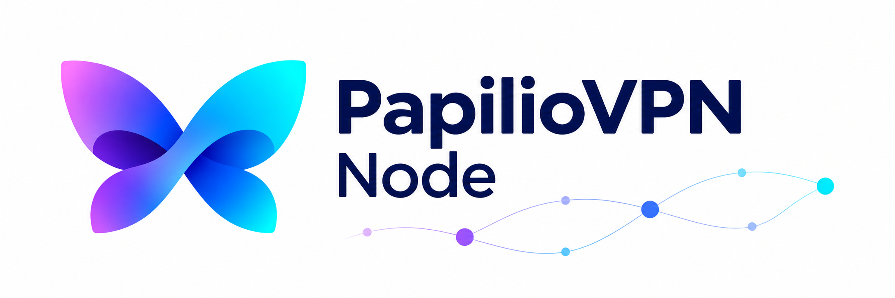

<p align="center">
  <picture>
    <source media="(prefers-color-scheme: dark)" srcset="assets/banner.png">
    <source media="(prefers-color-scheme: light)" srcset="assets/banner-light.png">
    
  </picture>
</p>

<h1 align="center">PapilioVPN Node</h1>

<p align="center" dir="rtl">سرویس نوشته‌شده با Go برای نودهای تحت مدیریت پلتفرم PapilioVPN.</p>

<p align="center">
  <a href="https://github.com/papilio-platform/Node/actions/workflows/ci.yml"></a>
  <a href="go.mod"></a>
  
</p>

<p align="center"><a href="README.md" lang="en">English</a> · <strong lang="fa">فارسی</strong></p>

<p align="center" dir="rtl">
  <a href="#current-capabilities">قابلیت‌ها</a> ·
  <a href="#quick-start">شروع کار</a> ·
  <a href="#development">توسعه</a> ·
  <a href="CONTRIBUTING.md">مشارکت</a>
</p>

---

<div dir="rtl">

<a id="current-capabilities"></a>

## قابلیت‌های فعلی

این نسخه، پایهٔ اجرایی و رابط خط فرمان پروژه را فراهم می‌کند.
مدیریت هسته‌ها و API کنترل شبکه هنوز در دسترس نیستند.

| قابلیت موجود | رفتار |
| --- | --- |
| مشاهدهٔ فرمان‌ها | راهنما، فرمان‌هایی را نشان می‌دهد که همین فایل اجرایی ارائه می‌کند. |
| بررسی نسخه | نسخه، نسخهٔ Go و پلتفرم هدف را به‌شکل خوانا نمایش می‌دهد. |
| اطلاعات ساخت ساختاریافته | خروجی JSON شامل revision و وضعیت تغییرات کد، در صورت درج توسط Go است. |
| بررسی روی Linux | در CI، رابط خط فرمان روی amd64 و arm64 به‌صورت native ساخته و آزمایش می‌شود. |

<a id="quick-start"></a>

## شروع کار

[Go نسخهٔ 1.26 یا جدیدتر](https://go.dev/dl/) را نصب کنید و سپس پروژه را از سورس بسازید:

<div dir="ltr">

```bash
git clone https://github.com/papilio-platform/Node.git
cd Node
go build -trimpath -o bin/node ./cmd/node
./bin/node help
./bin/node version
./bin/node version --json
```

</div>

این دستورها رابط خط فرمان نسخهٔ توسعه را می‌سازند. سرویس سیستمی نصب نمی‌کنند
و تنظیمات شبکه را تغییر نمی‌دهند. بسته‌های نصب نسخه‌دار هنوز منتشر نشده‌اند.

## راهنمای فرمان‌ها

| فرمان | نتیجه |
| --- | --- |
| `node help` | نمایش راهنما و فرمان‌های موجود؛ `-h` و `--help` هم پذیرفته می‌شوند. |
| `node version` | نمایش خوانای نسخه و پلتفرم. |
| `node version --json` | نمایش فیلدهای `version`، `revision`، `modified`، `go_version`، `os` و `arch`. |
| `node version --help` | نمایش گزینه‌های فرمان نسخه. |

خروجی نسخه از اطلاعات ماژول درج‌شده توسط Go استفاده می‌کند؛ در ساخت توسعه ممکن است
یک pseudo-version براساس commit باشد. اگر نسخهٔ ماژول موجود نباشد، `devel` گزارش می‌شود.
اگر اطلاعات VCS هنگام ساخت درج نشده باشد، `revision` خالی است؛ فایل اجرایی در زمان اجرا Git را فراخوانی نمی‌کند.
فیلد `modified` وضعیت کد در زمان ساخت را نشان می‌دهد، نه وضعیت فایل‌های سیستم مقصد.

کد خروج **0** به‌معنی موفقیت، **1** به‌معنی خطا در نوشتن خروجی و **2** به‌معنی
استفادهٔ نادرست است. خطای فرمان نامعتبر در stderr نوشته می‌شود.

<a id="development"></a>

## توسعه

فایل اجرایی فعلی از کتابخانهٔ استاندارد Go استفاده می‌کند و وابستگی زمان اجرای
شخص ثالث ندارد. بررسی‌های اصلی CI را می‌توانید به این شکل اجرا کنید:

<div dir="ltr">

```bash
gofmt -w cmd internal
go mod tidy
go mod verify
go vet ./...
go test -race -count=1 ./...
go build -trimpath -o bin/node ./cmd/node
```

</div>

CI همچنین یکسان‌بودن قالب‌بندی و وابستگی‌ها و آسیب‌پذیری‌های قابل‌دسترسی را با
نسخهٔ ثابت `govulncheck` بررسی می‌کند. نسخهٔ کامپایلر و ابزار بررسی در
[فایل CI](.github/workflows/ci.yml) مشخص شده‌اند. تست race به ابزار C پشتیبانی‌شده نیاز دارد.

## مشارکت

[راهنمای مشارکت](CONTRIBUTING.md) را بخوانید،
[مشکلی گزارش کنید](https://github.com/papilio-platform/Node/issues) یا
[درخواست ادغام بفرستید](https://github.com/papilio-platform/Node/pulls).
در گزارش خطا، اطلاعات ساخت و یک نمونهٔ قابل‌بازتولید را بنویسید.
هنگام تغییر رفتار، راهنمای انگلیسی و فارسی را با هم به‌روز کنید.

</div>
